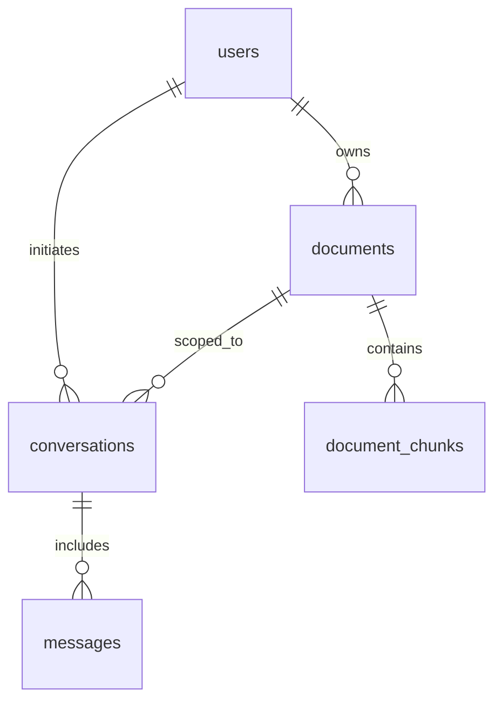

# Database Schema & Vector Indexing Design

SmartDocs AI relies on PostgreSQL with the official `pgvector` extension for storing metadata, conversation history, and high-dimensional dense embeddings.

---

## 1. Relational Entities & Relationships

---

## 2. Table Specifications

### `users`
Stores user authentication details and identity.
- `id` (UUID, Primary Key, Default: `gen_random_uuid()`)
- `email` (VARCHAR(255), UNIQUE, NOT NULL, Indexed)
- `password_hash` (VARCHAR(255), NOT NULL) - Bcrypt 12 rounds
- `full_name` (VARCHAR(255), NOT NULL)
- `created_at` (TIMESTAMPTZ, Default: `CURRENT_TIMESTAMP`)
- `updated_at` (TIMESTAMPTZ, Default: `CURRENT_TIMESTAMP`)

### `documents`
Stores catalog metadata and ingestion state for uploaded files.
- `id` (UUID, Primary Key)
- `user_id` (UUID, Foreign Key -> `users.id` ON DELETE CASCADE)
- `title` (VARCHAR(255), NOT NULL)
- `original_name` (VARCHAR(255), NOT NULL)
- `mime_type` (VARCHAR(100), NOT NULL)
- `file_size` (BIGINT, NOT NULL)
- `file_hash` (VARCHAR(64), NOT NULL) - SHA-256 for cryptographic deduplication
- `file_path` (VARCHAR(500), NOT NULL)
- `status` (VARCHAR(50), NOT NULL, Default: `'PENDING'`) - `PENDING` | `PROCESSING` | `READY` | `FAILED`
- `error_message` (TEXT, Nullable)
- `total_pages` (INT, Default: 0)
- `total_chunks` (INT, Default: 0)
- `created_at` (TIMESTAMPTZ)
- `updated_at` (TIMESTAMPTZ)

### `document_chunks` (Vector Store)
Stores text segments, page provenance, and vector embeddings.
- `id` (UUID, Primary Key)
- `document_id` (UUID, Foreign Key -> `documents.id` ON DELETE CASCADE)
- `user_id` (UUID, Foreign Key -> `users.id` ON DELETE CASCADE)
- `chunk_index` (INT, NOT NULL)
- `page_number` (INT, Nullable) - Preserved for PDF citations
- `chunk_text` (TEXT, NOT NULL)
- `embedding` (`vector(768)`) - Stores dense embeddings for cosine distance search
- `created_at` (TIMESTAMPTZ)

### `conversations`
Maintains conversational threads.
- `id` (UUID, Primary Key)
- `user_id` (UUID, Foreign Key -> `users.id` ON DELETE CASCADE)
- `document_id` (UUID, Nullable, Foreign Key -> `documents.id` ON DELETE SET NULL)
- `title` (VARCHAR(255), NOT NULL)
- `created_at` (TIMESTAMPTZ)
- `updated_at` (TIMESTAMPTZ)

### `messages`
Stores user questions, generated responses, and verified citation metadata.
- `id` (UUID, Primary Key)
- `conversation_id` (UUID, Foreign Key -> `conversations.id` ON DELETE CASCADE)
- `user_id` (UUID, Foreign Key -> `users.id` ON DELETE CASCADE)
- `role` (VARCHAR(50), NOT NULL) - `'user'` | `'assistant'` | `'system'`
- `content` (TEXT, NOT NULL)
- `citations` (JSONB, Nullable) - Array of validated citation objects
- `created_at` (TIMESTAMPTZ)

---

## 3. Vector Search Implementation & Indexes

### Cosine Distance Operator (`<=>`)
PostgreSQL pgvector provides three vector distance operators:
1. `<=>` : Cosine Distance (used by SmartDocs AI: `similarity = 1 - (embedding <=> query_vector)`)
2. `<->` : Euclidean (L2) Distance
3. `<#>` : Negative Inner Product

Cosine distance is chosen because normalized language embeddings from Gemini `text-embedding-004` represent semantic proximity through directional orientation rather than magnitude.

### HNSW vs IVFFlat Indexes
- **HNSW (Hierarchical Navigable Small World):**
  - **Syntax:** `CREATE INDEX idx_chunks_embedding_hnsw ON document_chunks USING hnsw (embedding vector_cosine_ops);`
  - **Trade-off:** Fast search query recall with logarithmic complexity. Requires more build memory (`maintenance_work_mem`), making it the premier choice for production.
- **IVFFlat (Inverted File Flat):**
  - Faster build times and smaller memory footprint, but requires periodic re-indexing and training data.
